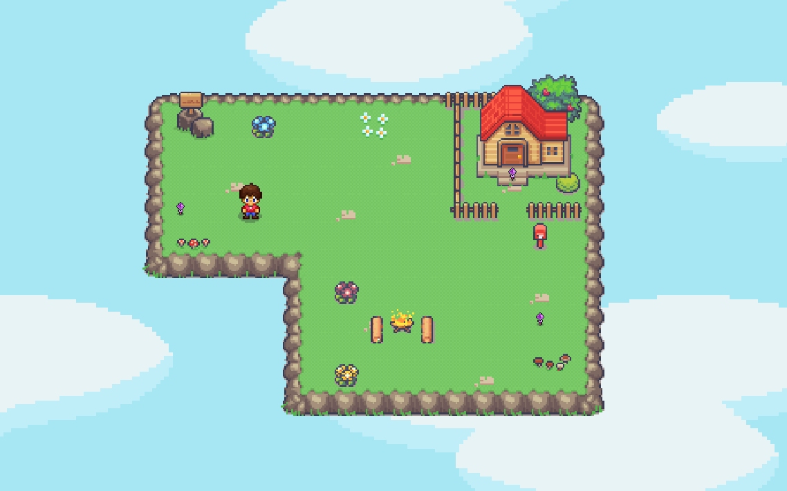
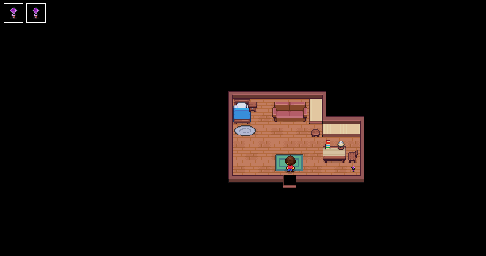
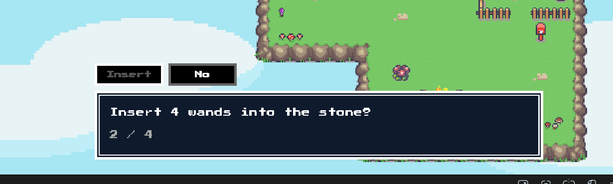

## 2D Game
A small top-down 2D game I'm building in plain JavaScript and HTML canvas, no game engine, it's made with Vite, and the maps are drawn in Tiled.

The idea: you wake up in a little island, collect 4 magic wands, and shove them into a mysterious stone. Something opens up, YOu jump in. Then the screen goes black and welll to be continued.

## Click here for [DEMO](https://2d-game-lake.vercel.app)



# How to run it 
You need Node installed
```
git clone https://github.com/shiz1ee/2d-game.git
npm install
npm run dev
```
Then open the localHost link

## Controls

|Key| What it does |
| --- | --- |
| WSAD / arrow keys | Move |
| E | Talk to the stone, confirm in the dialog |
| A / D | Pick insert or No in the dialog |
| Enter | Confirm in the dialog |
| Esc | Close the dialog |
| SpaceBar | Jump into the hole |
| R | Play again |


## What's in it so far

**The world**
- A village map and a little house interior, moth made in Tiled and loaded from json(who is json?).
- Walking through the door fades out and swaps you into the house (and back).
- Camera follow the hero, and in the small house it just stays centered cuz its a small house as the hero is poor.
- Collision uses a small hitbox around the hero's feet, so he can walk behind stuff without looking weird.
- Animated hero (walking, idle, picking up stuff), a campfire , a door, and a shadow under the hero.



**The wands**
- 4 wands to find: 3 in the island and 1 in the house.
- Each wand knows which scene it belongs to, so u cant grab the house one from the village.
- Collected wands show up in a little inventory in the top left.

**The stone**
- walk up to the big boulder and a bobbing **E** shows up.
- Pressing it opens a dialog box with a typewriter text, asking if you want to insert 4 wands.




**The hole and the jump**
- Once the wannds go in, a hole opens below the stone. Press Space and the hero hops in, and a black circle grows out of the hole until covers the screen.

**The ending** 
- A few seconds of black, then TO BE CONTINUED types out in glowing rred text . A PLAY AGAIN (R) box lets you restart.

**Sound**
- Sound effects for want pickup, the dialog, inserting the wands and the jump. No audio files, they're all synthesized with the Web audio API.

## Credits

- Island tiles: [Serene Village Rewamped](https://limezu.itch.io/serenevillagerevamped) by LimeZu
- House interior tiles: [Pixelart Interior Top-Down RPG Asset Pack](https://zedpxl.itch.io/pixelart-interior-top-down-rpg-asset-pack) by ZedPxl
- Font : Press Start 2P by google fonts
- Maps made with Tiled software.

The art belongs to the srtists above, so check their pages for their license terms before resuing anything.

## License
THe code is MIT, see `LICENSE`
